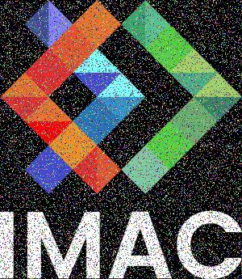
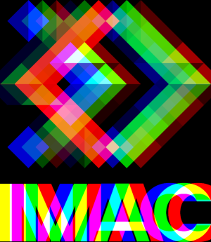
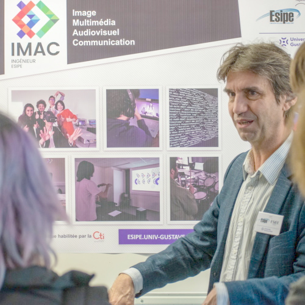
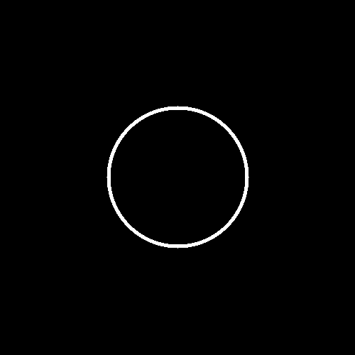
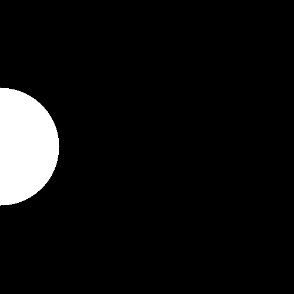
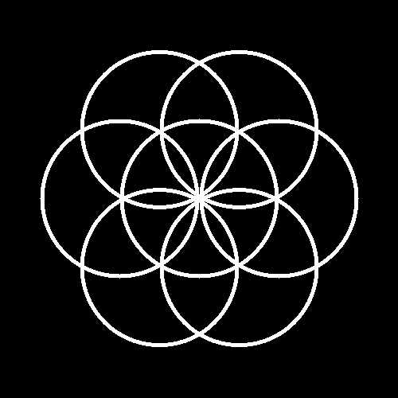

# 🐣 S1 | Prog: Workshop

# Rapport de projet 

## Ne garder que le vert

## Échanger les canaux

## Noir & Blanc

## Négatif

## Dégradé

## Miroir
Au départ, quand je lançais mon programme, l’image restait la même alors que j’inversais bien les pixels. C’était parce que j’appliquais le `swap` sur toute la largeur/hauteur, ce qui annulait l’inversion en remettant les pixels à leur place d’origine. J’ai donc divisé la boucle par 2.

## Image bruitée

## Rotation de 90°
Le point où j’ai eu un peu de mal est de remplacer l’ancienne image par la nouvelle et de gérer correctement les dimensions et coordonnées lors de la rotation sans écraser les pixels en cours de route.

## RGB split
Au niveau du décalage horizontal des canaux, sortir des limites de l’image faisait planter le programme. J’ai dû utiliser `std::min` et `std::max` pour borner les coordonnées et empêcher le dépassement.

## Luminosité

## Disque
Je suis parti de l’inéquation `(x - a)² + (y - b)² < R²` pour tester la position de chaque pixel par rapport au centre.

## Cercle

## Animation
Le point sur lequel j’ai bloqué est que je n’avais pas pensé à faire une boucle extérieure pour itérer l’opération frame par frame, ce qui m’a fait placer la sauvegarde dans les boucles de pixels. J’ai aussi dû faire attention au nommage des fichiers via `std::to_string`.

## Rosace
J’ai cherché comment passer de coordonnées polaires (angle et rayon) à des coordonnées cartésiennes (x et y), ce qui m’a permis d’utiliser `x = r × cos(θ) et y = r × sin(θ)` pour placer les centres des cercles et calculer la distance. J’ai aussi dû faire attention à ne pas effacer les cercles déjà tracés avec un else qui remet en noir, à répartir les angles sur 360° (60° pour 6 cercles), et à bien gérer les conversions `int` et `float` pour éviter les erreurs de compilation.

## Glitch
J’ai rencontré plusieurs difficultés pour cet effet, notamment dans la génération des coordonnées aléatoires et la gestion des limites de l’image, ce qui provoquait des dépassements de pixels et des erreurs lors de l’exécution du programme.

